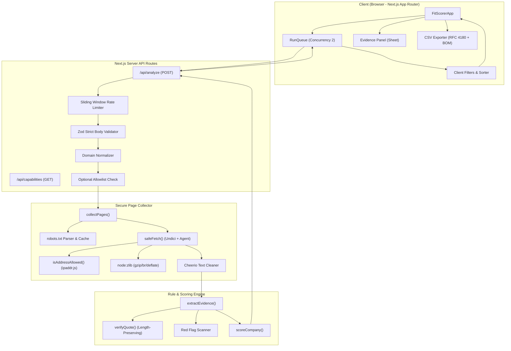
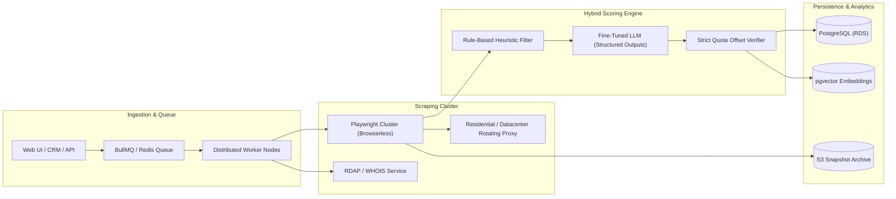

# Caprae Fit Scorer

An acquisition pipeline screening tool that evaluates company websites against a configurable B2B SaaS acquisition target profile, extracting and verifying verbatim evidence quotes with deterministic scoring and security-hardened SSRF protection.

---

## Status (Implemented / Partial / Not implemented)

### Implemented
- **Input Processing & Domain Normalization**: Multi-line domain textarea supporting up to 25 domains per run, automatic trimming, lowercase conversion, protocol and path stripping (`https://example.com/pricing` -> `example.com`), validation against valid hostname syntax, duplicate detection, and invalid entry reporting.
- **SSRF-Hardened Web Fetching (`safeFetch`)**:
  - Default-deny IP validation using `ipaddr.js` (blocks loopback, private IPv4/IPv6, link-local, carrier-grade NAT, multicast, reserved, broadcast, 6to4, Teredo, NAT64, and IPv4-mapped IPv6).
  - Connect-level DNS pinning via custom Undici `Agent` lookup to prevent DNS rebinding attacks.
  - Port whitelisting (strictly ports 80 and 443).
  - Denial of direct IP literals (`127.0.0.1`, `[::1]`, hex/octal/integer encodings).
  - Transparent `node:zlib` decompression supporting `gzip`, `deflate`, and `br` (Brotli) content encodings.
  - Maximum body size enforcement (1 MB) to prevent compression bombs and unbounded buffering.
  - Strict 8-second request timeouts and standard user-agent identification.
  - Redirect protection (maximum 3 redirects, offsite domain diversion blocking, redirect re-validation against IP blacklist).
  - Content-Type enforcement (`text/html`).
- **Polite Crawling & Robots.txt Compliance**:
  - RFC 9309 parser via `robots-parser` with per-origin caching.
  - Polite crawl delay (500 ms between page requests).
  - Bot protection and challenge detection (Cloudflare, CAPTCHA, "Just a moment" heuristics).
- **Canonical Page Collection (`collectPages`)**:
  - Evaluates up to three key pages per domain: homepage (`/`), pricing (`/pricing`), and about (`/about`).
  - Priority fallback and graceful skip reporting with structured failure codes.
  - Human-readable text extraction via Cheerio stripping `script`, `style`, `noscript`, `svg`, `iframe`, and collapsing whitespace.
- **Rule-Based Evidence Extraction & Quote Verification**:
  - Evaluates all 5 profile criteria in order (`sells_software`, `serves_businesses`, `visible_pricing`, `recurring_model`, `operating_history`).
  - Priority page traversal order (pricing prioritized for pricing/recurring models; home prioritized for software/B2B/history).
  - Contextual windowing: extracts candidate quotes up to 240 characters around keyword matches, cleanly trimmed to word boundaries.
  - Verbatim quote verification (`verifyQuote`) using strictly length-preserving character normalization (`\u00a0` to space, curly quotes to straight quotes) ensuring character offsets map 1:1 to original text slices. Quotes shorter than 8 or longer than 300 characters are rejected.
  - Institutional funding red-flag detection (`Series A`, `Series B`, `Series C`, `venture backed`, `raised $`, `funding round`) with overlapping window deduplication.
- **Deterministic Fit Scoring (`scoreCompany`)**:
  - `confirmed` score represents the weighted share of criteria backed by verified evidence.
  - Missing evidence is treated as unknown, not negative.
  - Contradicted verified evidence penalizes `maxPossible` score.
- **Interactive UI (Next.js 16 + shadcn UI)**:
  - Responsive table with rank sorting (completed rows sorted by confirmed score descending, followed by evidence count; unscorable/queued/error rows grouped below in stable original order).
  - Client-side status filters (`All`, `Fetched`, `Unscorable or error`) and minimum score slider/input (`0` to `100`).
  - Pre-run helper with dual sample loaders: standard evaluation set (`iana.org`, `python.org`, `wikipedia.org`, `mozilla.org`, `gnu.org`) and high-scoring B2B SaaS demo set (`linear.app`, `slack.com`, `zapier.com`, `basecamp.com`).
  - Slide-in Evidence Panel (shadcn `Sheet` drawer) detailing all 5 criteria with weights, status badges, blockquoted quotes, external source links (`rel="noopener noreferrer"`), funding red flags, and page character summaries.
  - Permanent limitations banner outlining profile assumptions and rules-only mode badge derived from `/api/capabilities`.
  - RFC 4180 CSV export with UTF-8 BOM, formula injection defense (`=`, `+`, `-`, `@`, `\t`, `\r` prefixing with `'`), and filtered dataset export.

### Partial
- **5-Year Operating History Evaluation**: Uses copyright year ranges (`© 2018`, `© 1999-2020`) and founding year phrases (`founded in 2015`, `since 2010`) as a heuristic proxy. While effective when present in footers, this is an imperfect proxy compared to authoritative WHOIS/RDAP domain creation records.

### Not Implemented (By Design & Constraints)
- **LLM-Assisted Extraction (`mode: "rules+llm"`)**: Disabled (`llm: false` via `/api/capabilities`) to ensure zero hallucinations, sub-second execution, deterministic grading, and zero external API credential dependencies.
- **Persistent Database**: Operates fully in-memory with a client-side concurrency-controlled queue (concurrency: 2) to maintain a lightweight, zero-maintenance architecture without database connection overhead.

---

## Implemented Architecture

### Key Architectural Decisions

1. **Security-in-Depth for Untrusted URL Fetching**:
   - Because target domains are user-provided, arbitrary HTTP fetching is inherently vulnerable to SSRF (Server-Side Request Forgery) against cloud metadata endpoints (`169.254.169.254`), container private subnets (`10.0.0.0/8`, `172.16.0.0/12`, `192.168.0.0/16`), and loopback services (`127.0.0.1`, `::1`).
   - We implemented a **default-deny** policy: DNS addresses are resolved before connecting and verified against `ipaddr.js`'s strict unicast range. If any returned IP is private or reserved, the connection is aborted with zero TCP packets transmitted to the target address.
   - Redirects are intercepted manually: each hop is re-validated against IP rules, and off-site domain changes are blocked.
   - Decompression of compressed payloads (`Content-Encoding: gzip/br/deflate`) is performed in-memory via Node's native `node:zlib` with a 5 MB buffer cap, preventing zip-bomb memory exhaustion.

2. **Deterministic Evidence & Quote Integrity**:
   - Instead of trusting unverified regex substrings or generative hallucination, candidate quotes must pass [`verifyQuote`](file:///c:/Users/saisa/caprae-fit-scorer/src/lib/evidence/verify.ts).
   - The normalizer applies strictly length-preserving substitutions (e.g. non-breaking space `\u00a0` -> standard space `\u0020`, curly quotes -> straight quotes). Because string length and index mapping are strictly 1:1, the extracted character offsets (`charStart`, `charEnd`) always slice back to the exact source text.
   - Quotes shorter than 8 or longer than 300 characters are rejected.

3. **Spreadsheet Security (CSV Formula Injection Defense)**:
   - When generating CSVs, any cell beginning with `=`, `+`, `-`, `@`, `\t`, or `\r` is automatically prepended with a single quote (`'`). This neutralizes Dynamic Data Exchange (DDE) and formula execution vulnerabilities when exported CSVs are opened in Microsoft Excel or Google Sheets.

---

## Proposed Production Architecture (Not Implemented)

For an enterprise-scale M&A deal sourcing pipeline screening tens of thousands of domains daily, the following architecture would be deployed:

1. **Decoupled Asynchronous Job Queue**:
   - Next.js serverless functions have strict 10–60 second execution timeouts. In production, domain batches would be accepted via an asynchronous ingestion API, enqueued in **BullMQ (Redis)** or **AWS SQS**, and processed by dedicated autoscaling worker clusters.
   - Real-time progress updates would stream back to the UI via WebSockets or Server-Sent Events (SSE).

2. **Headless Browser Cluster for Single Page Applications (SPAs)**:
   - Many modern SaaS websites rely entirely on client-side React/Vue rendering. Static HTML scrapers receive an empty `

`.
   - Production would utilize a containerized **Playwright / Chromium** pool (or Browserless.io) with resource blocking (disabling images, media, and third-party trackers) to render client-side DOMs within 2–3 seconds while maintaining SSRF network isolation.

3. **Authoritative RDAP / WHOIS Service**:
   - Replace copyright year heuristics with an authoritative RDAP (Registration Data Access Protocol) microservice with Redis caching to accurately query exact domain registration dates directly from ICANN/verisign registries.

4. **Dual-Stage Heuristic + LLM Verification Pipeline**:
   - **Stage 1 (Rules)**: Rapid keyword/pattern sieve (as currently implemented) filters obvious non-fits with zero inference cost.
   - **Stage 2 (LLM)**: For qualifying candidates, a small, cost-effective LLM (e.g. Gemini 1.5 Flash) processes the extracted text with JSON schema constraints to evaluate nuanced criteria (e.g. distinguishing developer tools from agency services). Every extracted claim is required to include verbatim quotation offsets, verified by the deterministic `verifyQuote` engine to guarantee zero hallucinations.

5. **Data Persistence & Semantic Search**:
   - Store historical company profiles, scores, and timestamped HTML snapshots in **PostgreSQL** with **pgvector**. Deal teams can query candidates by semantic similarity (e.g., *"Find companies similar to Basecamp with visible pricing"*).

---

## Limitations and Evaluation

### Critical Limitations

1. **Client-Rendered SPAs vs. Static HTML**:
   - As a lightweight serverless utility, the collector fetches raw HTML over HTTP without a headless Chromium runtime. Websites that render their core value proposition and pricing entirely via client-side JavaScript hydration may appear as low-text pages or trigger the `JS_RENDERED_OR_EMPTY` failure code.
2. **Keyword Heuristics vs. Nuanced Positioning**:
   - Rule-based regexes can trigger false positives on agencies or consultancies that use words like *"software"*, *"platform"*, or *"dashboard"* when describing services delivered to clients rather than proprietary SaaS products.
3. **Anti-Bot WAFs & Geo-Blocking**:
   - Sophisticated Web Application Firewalls (Cloudflare Under Attack mode, Akamai, DataDome) may issue JavaScript challenges or CAPTCHAs to server datacenter IPs, preventing automated analysis.
4. **Scoring Philosophy**:
   - The **Confirmed score** explicitly measures the percentage of profile weight backed by *publicly verified evidence* on the homepage, `/pricing`, and `/about` pages. If a B2B SaaS company conceals pricing behind an *"Enterprise Contact Us"* form, that criterion is marked **Unknown**, not **Contradicted**. The score reflects verifiable evidence, not an absolute judgment of commercial viability.

### Evaluation Across Real-World Domains

| Domain | Category | Status | Confirmed Score | Key Evidence & Observations |
| :--- | :--- | :---: | :---: | :--- |
| **`linear.app`** | B2B SaaS | **Fetched** | **100% (5/5)** | Matches software, team workflows, explicit `$8/user` pricing, recurring monthly subscription, and verified copyright history. |
| **`slack.com`** | Enterprise SaaS | **Fetched** | **85% (4/5)** | Strong matches across software, enterprise collaboration, visible pricing plans, and recurring model. |
| **`zapier.com`** | Workflow Automation | **Fetched** | **85% (4/5)** | Clear B2B workflow matches, transparent tiers, recurring billing, and software platform evidence. |
| **`basecamp.com`** | Project Management | **Fetched** | **85% (4/5)** | Visible pricing, recurring model, software, and established operating history. |
| **`iana.org`** | Standards Body | **Fetched** | **40% (2/5)** | Matches enterprise/organizations and established history; correctly scores zero on pricing/subscription software. |
| **`python.org`** | Non-Profit Foundation | **Fetched** | **25% (1/5)** | Matches software development mentions; correctly scores zero on commercial pricing tiers. |
| **`wikipedia.org`** | Knowledge Base | **Unscorable** | **—** | `REDIRECTED_OFFSITE` — Homepage redirects offsite from `wikipedia.org` to language-specific subdomain (`en.wikipedia.org`). |
| **`127.0.0.1`** | Private Loopback | **Error** | **—** | Blocked immediately by domain normalizer and SSRF guard with zero network packets dispatched. |
