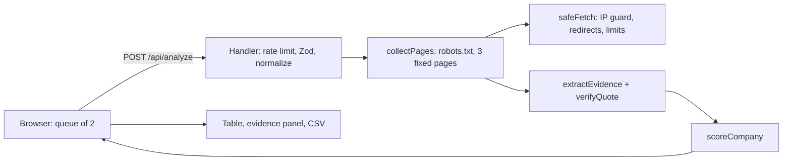

# Caprae Fit Scorer

A screening aid for acquisition research. Paste company domains. The app fetches each company's homepage, `/pricing` and `/about`, extracts keyword-based evidence for five criteria of an **illustrative** profile (not Caprae's criteria), checks that every quote really appears on the fetched page, and ranks companies by a deterministic score. Every point of every score links to a quote and its source page.

- **Repository:** https://github.com/SantoshAdapa/caprae-fit-scorer
- **Live demo:** https://caprae-fit-scorer.vercel.app/
- **Video walkthrough:** https://drive.google.com/file/d/1BKnarp2eipH3xwdGfyuwUzvLFK60XHNE/view?usp=sharing

## Status

| Feature | Status |
| --- | --- |
| Domain input, normalization, dedupe (max 20 per run) | Implemented |
| Safe fetching (SSRF guard, redirects, size/time limits, robots.txt) | Implemented |
| Evidence extraction for 5 criteria (keyword rules) + funding-mention flag | Implemented |
| Quote verification against fetched text | Implemented |
| Deterministic scoring, ranked table, evidence panel, filters | Implemented |
| CSV export (RFC 4180, formula-injection prefixing) | Implemented |
| Per-IP rate limiting | Partial (in-memory, per server instance) |
| AI extraction | **Not implemented** |
| Database / saved runs (Supabase) | **Not implemented** |
| Page caching | **Not implemented** (robots.txt is cached within one analysis) |
| Headless browser for JavaScript sites, CI, evaluation set | **Not implemented** |

The app is **rules-only**. There is no AI in the running product.

## Tech stack and hosting (implemented)

- Next.js 16 (App Router, TypeScript strict), Tailwind CSS, shadcn/ui.
- Hosting: Vercel, serverless functions on the Node.js runtime.
- Storage: none. State lives in the browser; the server is stateless (one domain per request, two in flight at a time).
- Caching: none beyond robots.txt within a single analysis.



## How scoring works

Five criteria with weights: sells software 25, serves businesses 25, visible pricing 20, recurring model 15, operating history 15 (stated founding or "since" year at least 5 years back).

`confirmed = round(100 * weight of criteria with a verified "met" quote / total weight)`. No evidence means **unknown, not negative**. The model supports a "contradicted" status and a `maxPossible` score, but the keyword rules never produce "contradicted", so `maxPossible` is always 100 in practice. A "Funding mention" badge appears when text such as "Series A" or "raised $" is found; it detects mentions, not funding status.

## Security design

- IP addresses are checked inside the DNS lookup used for the connection; only public unicast addresses are allowed (private, loopback, link-local, carrier-grade NAT, multicast, reserved and IPv4-mapped ranges are rejected). If any resolved address is disallowed, the request is refused. IP-literal hosts are rejected outright, including in redirects.
- Only ports 80/443. At most 3 redirects, each fully revalidated; redirects must stay on the same site (so `wikipedia.org` is reported unscorable).
- 8 s timeout per request, 1 MB limit on the compressed body, 5 MB limit on the decompressed body (gzip, deflate, brotli).
- robots.txt is honored (4xx allowed, 5xx or network error treated as disallowed). Fixed crawler User-Agent, 500 ms delay between requests. CAPTCHAs and bot challenges are reported, never bypassed.
- API responses never include page text, internal error details, or resolved IP addresses.
- **Evidence:** automated tests (131, across 14 test files; run `npm test`), including a test that a name resolving to 127.0.0.1 is blocked with zero connections to a local server; and a manual check on the deployed app on October 11, 2026 where names that resolve to 127.0.0.1, 169.254.169.254 and 10.0.0.1 were blocked.
- **Not claimed:** no independent security review; DNS rebinding with a hostile resolver was not tested in production. The rate limiter is per server instance and trusts `x-forwarded-for`, so it is best-effort only.

## Limitations (read before trusting a score)

- The rules are coarse keyword matching. Verification proves a quote exists on the page, **not** that it means what the keyword suggests.
- In my runs the scorer separates commercial SaaS sites from non-commercial sites, but it does not meaningfully rank SaaS companies against each other, and it says nothing about whether a company is an acquisition target.
- Only the homepage, `/pricing` and `/about` are read. Sites using other paths show "unknown".
- JavaScript-rendered or bot-protected sites are reported as unscorable. Operating history relies on explicit phrases like "founded in 2015".
- There is no request body size limit beyond the platform's. Exported CSV cells starting with `=`, `+`, `-` or `@` get a leading apostrophe.
- `npm audit` reports high-severity advisories in build-time tooling (`shadcn` dependencies); none are in runtime packages used for fetching or parsing. They were not fixed.
- Local development and builds need internet access for Google Fonts.

## Example outputs (single illustrative run on October 12, 2026; not an evaluation)

| Domain | Result |
| --- | --- |
| linear.app | 100% (5/5) |
| slack.com, zapier.com, basecamp.com | 85% (4/5) each |
| mozilla.org, gnu.org | 15% (1/5) each |
| iana.org, python.org | 0% (0/5) each |
| wikipedia.org | Unscorable (redirected off-site) |

No ground-truth labels were created, so no accuracy is claimed. These outputs illustrate current keyword heuristics on live pages.

## Proposed production architecture (not implemented)

- **Persistence:** Supabase Postgres for saved runs and evidence, with row-level security and the service key kept server-side only.
- **Caching:** a page cache table keyed by URL with a 24-hour TTL.
- **AI extraction:** optional structured extraction for fuzzy criteria, with every quote passing the same verifier and an automatic rules-only fallback when unavailable.
- **Batches:** a queue and workers for runs larger than a serverless function allows; distributed rate limiting.
- **Coverage:** a headless browser for JavaScript sites; an authoritative domain-registration source for operating history.
- **Deployment:** GitHub to Vercel (already used), CI running lint, typecheck, tests and build on every push, database migrations via the Supabase CLI.

## Run it

Requires Node.js 20.9 or newer (developed on Node 24).

```
npm ci
npm run dev        # http://localhost:3000
npm test           # run test suite (131 tests across 14 test files)
npm run lint       # eslint
npm run typecheck  # TypeScript check
npm run build      # production build
npm run check      # runs lint, typecheck, tests, and build together
```

All environment variables in `.env.example` are optional and unused by the current feature set.

## Engineering time

About 5 h 18 min (318 minutes) of engineering recorded through Task 9 in `HOURS.md` (self-reported with a stopwatch; early rows are reconstructed estimates). This recorded total exceeds the 5-hour assignment limit by 18 minutes; subsequent audit and review work is tracked separately for final candidate reconciliation. Setup, reading, documentation and the video are excluded. Tasks 6 and 7 plus several fixes were committed together, so the Git history is coarser than the work. I can't offer independent verification of the hours.